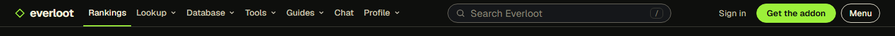
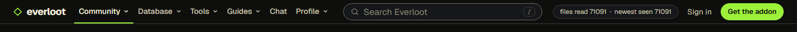
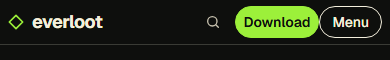
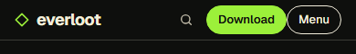
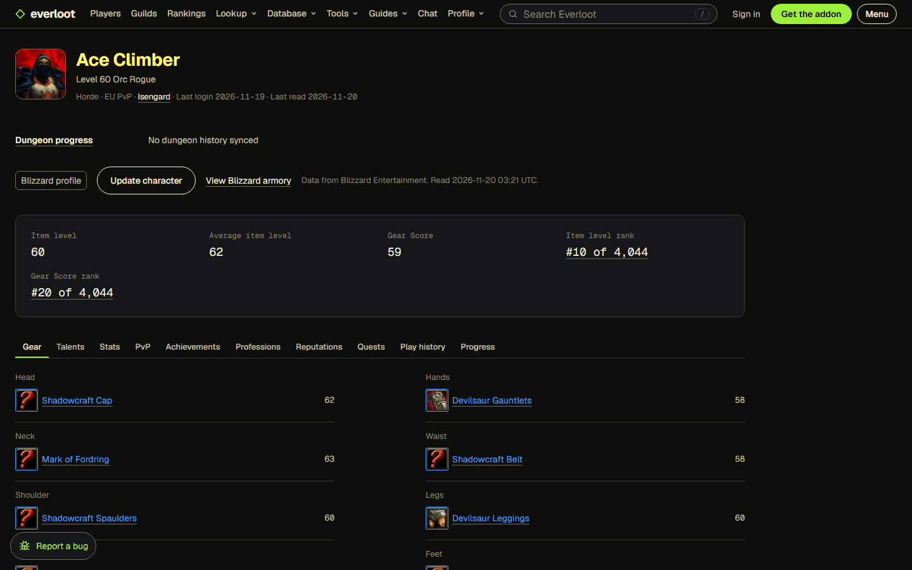
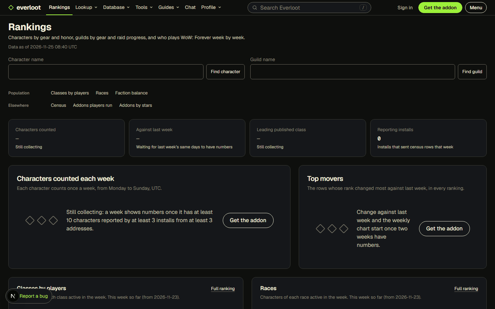
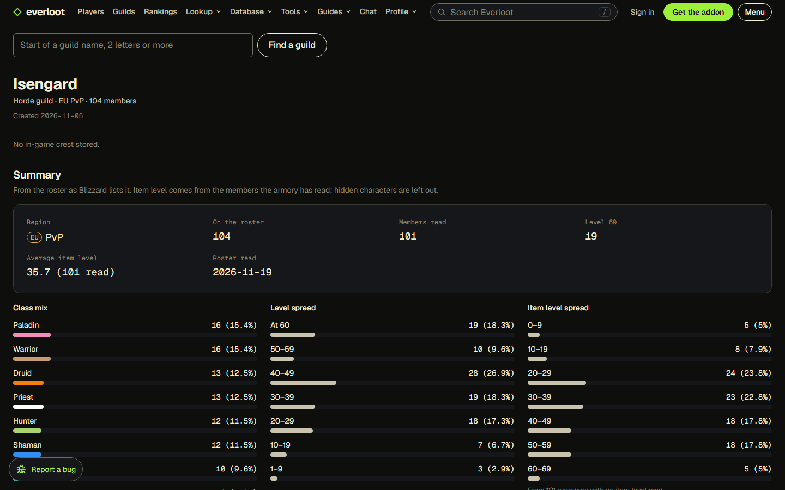
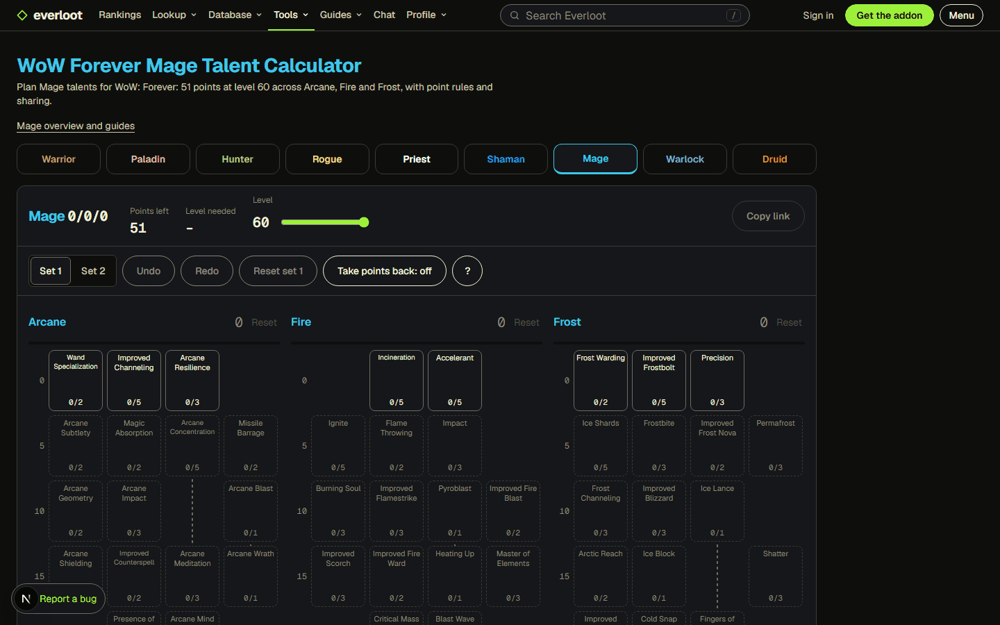

# Everloot: design direction

**Date:** 2026-11-25. **Status:** the rules the shared shell and base components follow; pages adopt them as their
lanes touch them. It builds on `specs/2026-10-19-design-system.md` (components) and the density spec in
`web/src/design/tokens.ts` (`DATA_TYPE`, `DATA_SIZE`). Where this page and an older spec disagree, this page wins.

## What it should feel like

Players of WoW: Forever come to Everloot with the game open on another screen and a question: what drops this, what
is my alt wearing, how is my guild doing. The site should feel like a well-kept reference book next to the game: quiet,
dark, dense, quick to scan. The game supplies the colour. Item quality, class and faction colours are what you look for,
so the frame around them stays neutral: warm off-black surfaces, hairline edges, one green accent. There is no fantasy
dressing (no parchment, gold trim, glow or display type). The one character is Glint, and he stays in his corners.

## Type

Geist for words, Geist Mono for **numbers, ids, builds and dates only**. A label is a word, so it is sans, even
when the value under it is a number. One scale, in px (size/line height):

| Step | Class | Size | Where |
|---|---|---|---|
| Page title | `text-title-sm sm:text-title` | 22/28 → 28/34, 700 | The one h1, through `PageHeader` or `DataTitle`. |
| Section | `SectionHeading` | 20/28, 600 | Section openers on hubs, tools and profile pages. |
| Data section | `text-h2-sm sm:text-h2` | 15 → 16, 600 | Sections inside a database or entity page, over a table. |
| Body, cell | `text-cell` | 14/20 | Table cells, ledes, running text on data pages. |
| Meta, control | `text-meta`, `text-control` | 13/20 | Meta lines, fact labels, tabs, filter buttons, small pills. |
| Small | `text-th`, `text-cell-2`, `text-xs` | 12/16 | Table headers (600), a cell's second line, group labels, badges. |
| Caption | `text-caption` | 11 | Chart labels beside a figure, nothing else. |

Prose pages (`ReadingLayout`) keep 16 px body text. The home hero is the one display size.

## Colour

| Token | Use |
|---|---|
| `canvas` #0E0F0D, `panel` #15171A | Page and raised surfaces. A card, a menu and a table frame are `panel`. |
| `line` | Decorative hairlines: card edges, row rules, the header's bottom edge. |
| `edge` | Edges a control needs you to see (inputs, filter chips, the unconfirmed dash): 3.6:1 on canvas. |
| `fg` / `fg-2` / `muted` | Names and values / secondary text and nav items / labels and meta. 16.7, 10.9 and 5.3:1 on canvas (5.0 on panel). |
| `accent` #9CF03A | Fills, focus rings, the current-item underline, a count that matters. **Never link text**: it reads as an uncommon item name (the guard test bites `text-accent` with `underline`). |

**Game colours are data and need a reason to appear:**

- `q-*` (item quality) only on an item's name, its icon border and a quality badge.
- `class-*` only on a character's or class's name, class bars in charts, and the class picker. Not on a tool's page
  title, except the talent calculator, which is about that one class.
- `faction-*`, `realm-*`, `region-*` only on that fact's own chip or series.
- `blue-post` only for Blizzard staff. `tip-yellow` and the coin metals only inside tooltips and prices.

Every text token passes 4.5:1 on canvas and panel; `tokens.test.ts` keeps it so. This pass changes no colour value.

## Spacing and density

Spacing is the scale 4 8 12 16 24 32 48 72 (`1 2 3 4 6 8 12 18`), nothing between. Data pages run dense: header to
title 16, title to filters 12, filters to table 8, between sections 24. Hubs and tools give sections 48. The page gutter
is 16 px on a phone and 24 px from 1024 px, and the header uses the same gutters, so the logo, the title and the
first table column share one left edge.

## Components

- **Page header.** `PageHeader` (or `DataTitle` on lists): title, one-line lede, a meta row, actions at the right.
  Nothing above the title. Actions are `.btn btn-sm` pills, and only one is primary.
- **Buttons.** Pills only. `.btn` (44 px) for a form's own submit and the call to action in an empty state;
  `.btn btn-sm` (32 px, 13 px text) in the header and beside a title, filter bar or table. `btn-primary` once per
  view. A link that leaves the site is a text link, not a third button shape.
- **Card.** `Card`: panel fill, `line` edge, 12 px corners, 24 px padding (16 for tiles). A link card's edge turns
  accent on hover. No shadow, no lift. Stat tiles are `Facts`, not hand-made cards.
- **Table.** `DataTable`. Dense lists: no frame, 36 px rows, sticky 32 px sans headers. Framed tables (a section
  inside a page) use the same 32 px sans `text-th` headers and 14 px cells; numbers are right-aligned mono with
  tabular figures; names wear their quality colour.
- **Tabs.** `Tabs` (hash) or `LinkTabs` (URL): 13 px labels, the accent underline on the open tab, a hairline under
  the strip, counts in muted, empty tabs left out.
- **Badges.** The four tones in `Badge`, sans 12 px medium with tabular figures. The unconfirmed mark is the hollow
  diamond, never a chip.
- **Facts.** Labels sans in `muted`; values mono only when `numeric`.

## Navigation

Eight items instead of nine plus Menu: **Players · Guilds · Community · Database · Tools · Guides · Chat · Profile**.
Players and Guilds stand in the bar itself (owner, 2026-11-25): the character and guild pages are what most visitors
look for. Without their switches the bar is the six others.

- Community: Players, Guilds (when on; the Guild board before that), Rankings, Census, Addons. The people pages.
- Database: unchanged (overview, items, NPCs, quests, zones, spells, world map).
- Tools: Auction House, Bag upgrades, Disenchanting, then Raid builder, Talent calculator, Professions, All tools.
- Guides, Chat, Profile: unchanged.

From 1280 px the bar shows every item, and Menu is gone (it used to repeat the bar up to 1535 px). The build chip
joins at 1536 px so the search field keeps about 240 px at 1280; the footer shows both builds at every width.
Below 1280 px Menu lists the same menus as groups, then More (Chat, Docs, About, Report a bug). No destination was
dropped; `header.test.tsx` checks every one is still one click from the header or footer.

## Motion

Unchanged from `MOTION` in `tokens.ts`: colour changes and menus fade in 150 ms, menus leave in 100, a press scales to
0.98, nothing loops but Glint, and nothing moves under `prefers-reduced-motion`. No new motion in this pass.

## What the audit found (2026-11-25, local dev server and production, 1440 and 390 px)

1. **The bar was crowded and repeated itself.** Nine top items (Players, Guilds, Rankings, five menus, Chat), and the
   Menu button still showed beside them up to 1535 px, listing the same places again. "Lookup" mixed people pages
   with market tools. *Fixed here.*
   
   
2. **The phone bar had no right gutter.** Menu sat 8 px from the edge and touched Download. *Fixed here (16 px
   gutter, 4 px gap).*
    
3. **Three button shapes in one row.** The character page puts a 6 px-corner box ("Blizzard profile"), a 44 px pill
   ("Update character") and an underlined link ("View Blizzard armory") side by side; Rankings uses 6 px-corner
   "Find character" boxes. *`.btn-sm` added here; lanes B and C adopt it on their pages.*
   
4. **Labels in mono.** Fact labels ("Item level", "Gear Score"), footer group names, the phone menu's group names,
   badges and framed table headers were Geist Mono, which the design system keeps for numbers. Mono labels over mono
   values made the stat tiles read as a terminal. *Fixed in the shared pieces here.*
5. **Two table header styles.** Dense lists used 32 px sans headers; framed tables used 36 px mono ones. *Fixed here.*
6. **Hand-made stat cards.** Rankings' four tiles and the character's item-level panel are page-built boxes, each
   with its own padding and a large empty area under one number. *Lanes B and C: use `Facts`.*
   
7. **A search form above the guild's name.** The guild page opens on "Find a guild" before the guild itself, and the
   crest line says "No in-game crest stored" as body text. *Lane C.*
   
8. **Underlined section names.** The character page's "Dungeon progress" label is underlined like a link and sits in
   a row of its own. *Lanes B and D.*
9. **Accent as headline colour.** "Every reset." on home and the second line on chat use the accent as text. It is
   large type, so not mistaken for an item, and it stays; do not spread it to other titles.
10. **Class colour on a tool's title.** The talent calculator's title is the allowed exception above; the class
    picker under it shows every class colour at once, which is right for a picker.
    

## Changed in this pass (other lanes rebase on these)

`components/Header.tsx`, `components/AccountControls.tsx`, `components/Footer.tsx`, `components/ui/Badge.tsx`,
`components/ui/DataTable.tsx`, `components/ui/Facts.tsx`, `components/ui/ReadingLayout.tsx`, `app/globals.css`
(`.btn-sm`). Card, Tabs, LinkTabs, PageHeader and the tokens already follow these rules and are unchanged.
